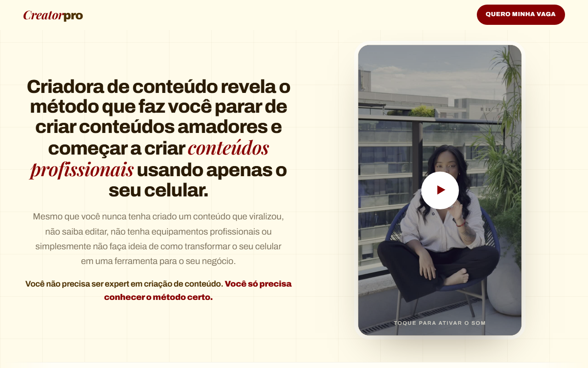
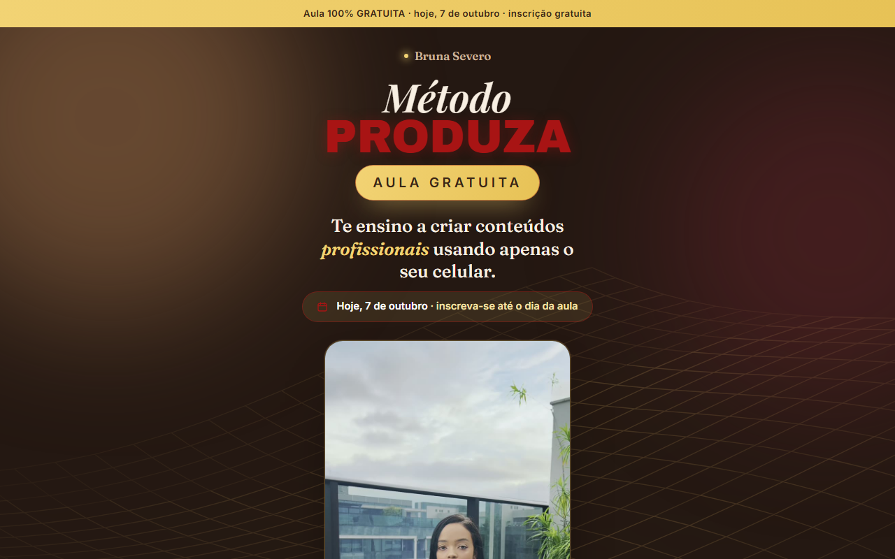

## Beto Hardman

**AI Automation Engineer | Web Designer | UI/UX**

Landing pages, sites e automacao com IA. Brasilia, Brasil.

Estudando Java e Spring Boot. Site: https://betohardman.cloud

---

## Sites no ar

### Luna Toys

Vitrine de aluguel de brinquedos inflaveis, com contato direto por WhatsApp.

https://lunatoys.com.br

### Creator Pro

Pagina de vendas com VSL. O botao de compra so aparece depois da metade do video, quem pausa recebe uma mensagem na tela, e o player nao permite download.

https://metodocreatorpro.com.br

### Metodo Produza

Landing page de aula com inscricao e video de apresentacao.

https://brunasevero.com.br

---

## Como eu construo

HTML, CSS e JavaScript puro, sem framework e sem build. Deploy na Vercel com dominio proprio, HTTPS e cabecalhos de seguranca. Cache imutavel nos assets e layout testado no celular antes do desktop.

Pagina leve abre no 4G do cliente. Pagina pesada nao vende.
